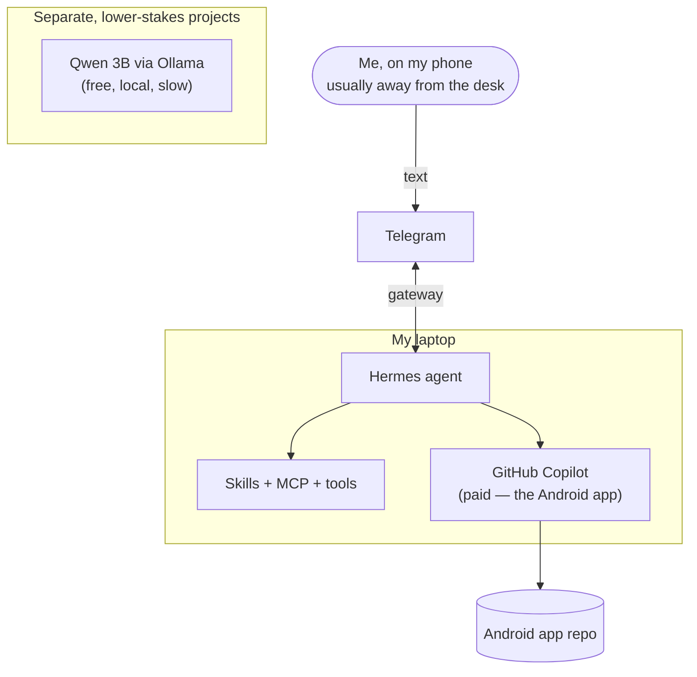

+++
date = "2026-08-30"
linktitle = "The agent in my pocket: how a side project survived a life with no free time"
type = ["post", "posts"]
title = "The agent in my pocket: how a side project survived a life with no free time"
weight = "10"
series = ["AI", "LLM", "Hermes Agent", "Software Development"]
[ author ]
 name = "Harshit Joshi"
+++

I have a toddler and a side-project Android app, and for a while I'd made my peace with the fact that only one of those was going to get built. Then I put [Hermes Agent](https://hermes-agent.nousresearch.com/) on my laptop and started talking to it through Telegram, and the app came back to life. (One day I got so into it I ran up 7,000 GitHub Copilot credits before I looked up — but that's a footnote, not the point.)

This isn't a how-to — the Hermes site covers what it is and how to set it up. This is about my particular setup, why the phone matters more than I expected, and the one thing I got wrong about running a cheap local model alongside the paid one.

## Why Hermes and not OpenClaw

I looked at OpenClaw first — it's the closest thing out there, and honestly they're built on the same idea: a local assistant that runs on your own machine, talks to Telegram and the rest, and gets extended with skills and plugins. Two things tipped me to Hermes. First, memory: Hermes keeps one persistent memory across everywhere I talk to it and remembers how it solved something last time, so it gets more useful the longer I use it. OpenClaw doesn't really put memory front and centre. Second, safety: Hermes has sandboxing built in, whereas OpenClaw runs tools directly on your machine unless you go set that up yourself. Since this thing has real access to my code and files, I'd rather that guardrail come in the box. OpenClaw is the more build-it-yourself option; Hermes was closer to something I could just start using — which, given how little free time I have, was the deciding factor.

## The setup

Two things about this that matter more than the rest.

## The phone is the whole point

I have a toddler at home. My working day is not a working day — it's a scatter of ten- and twenty-minute windows between the things a small child needs. I can't reliably sit at a desk. What I *can* do is send a message.

So Hermes runs on the laptop, where it has real access to the code, and I reach it from my phone through Telegram. I kick something off — "add the settings screen, wire it to the store, run the build" — put the phone down, and go deal with the toddler. It works while I'm not watching and pings me when it's done or stuck. When I get a free minute I check what it did and point it at the next thing.

That's it. That's the unlock. Before this, a side project meant finding a two-hour block, and two-hour blocks don't exist in my life right now. Turning the work into something I can drive from my phone in the gaps is the only reason the app is getting built at all. The credits I burned are really just a measure of how many of those dead minutes turned into progress.

## The local-model idea that didn't pan out the way I wanted

The plan was tidy: pay for Copilot for the hard work, and when the budget runs low, fall back to a small open-source model running locally through Ollama (Qwen, 3B). Free, always on, no meter.

In practice the gap is bigger than "a bit worse." Qwen can write code, but it's slow, and on anything non-trivial the quality difference against the paid model is large enough that I spend more time fixing its output than I saved. For the kind of work the Android app needs, it's mostly not worth it.

What I actually landed on: **I don't mix models on the same project anymore.** Switching engines mid-project on the app just produced a mess — inconsistent code I then had to reconcile. So Copilot owns the app, start to finish. Qwen still gets used, but on *separate*, lower-stakes projects where slow-and-rough is fine and I'm not going to care about the seams. Keeping them in their own lanes is the fix. Sharing them was the mistake.

## What I'd actually tell you

If you want to try this, the parts list is the easy bit. The two things I'd pass on:

- **If your time comes in fragments, put the agent behind a text message.** The laptop gives it hands; the phone gives you a doorway that costs nothing to walk through. That combination is what makes a side project survive a life with no free blocks in it.
- **A free local model is a real fallback, not a real substitute — so give it its own work.** Don't split one project across a strong model and a weak one. Let the good one finish what it started, and hand the cheap one things where rough is good enough.

## What's next

Two things I want to add and will write up once I've actually run them for a while, not before. First, [OpenRouter](https://openrouter.ai/), so I'm not tied to a single model provider and can pick whatever's best or cheapest for a given job without rewiring anything. Second, [Langfuse](https://langfuse.com/), so I can actually see what the agent is doing — which calls cost what, where it's wasting effort, what a day like the 7,000-credit one was really spent on. Right now that's a black box, and the day I burned through the budget I had no breakdown of where it went. I'll come back with how those land.

The app is getting built. Not in the two-hour blocks I don't have, but in the ten-minute ones I do. That's the whole story — the agent didn't give me more time, it just let me use the time I was already spending on something else.

## References

Setup and docs, if you want to build your own version of this:

- [Hermes Agent](https://hermes-agent.nousresearch.com/) — the agent I use; site covers the desktop app, install, and the channel/memory/sandboxing features.
- [Nous Research](https://nousresearch.com/) — the team behind Hermes.
- [OpenClaw (GitHub)](https://github.com/openclaw/openclaw) — the closest alternative; useful to read even if you pick Hermes, and its security/sandboxing guides are worth a look.
- [ClawHub](https://github.com/openclaw/clawhub) and [awesome-openclaw-skills](https://github.com/VoltAgent/awesome-openclaw-skills) — skill and plugin registries; good for ideas on what to teach an agent, and many concepts carry over.
- [Ollama](https://ollama.com/) — the simplest way to run open models locally; how I run the small fallback model.
- [Qwen](https://qwenlm.github.io/) — the open-source model family I use locally through Ollama.
- [Telegram Bot API](https://core.telegram.org/bots) — background on the messaging channel that acts as my doorway to the agent.
- [OpenRouter](https://openrouter.ai/) and [Langfuse](https://langfuse.com/) — the two things I'm adding next (see above).

